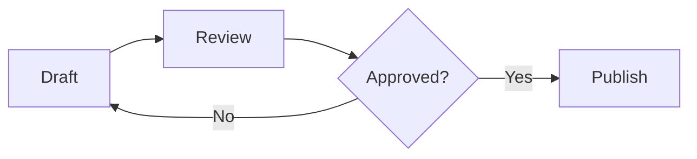

# BarkDown Mermaid

Put a fenced block labeled `mermaid` in a Markdown file. The BarkDown preview
renders it as a diagram. No script tag, SVG file, or companion HTML is needed.

Save the document as `.md` or `.markdown` so the preview loads it as Markdown.

## Write this in `report.md`

````markdown
## Review flow


````

The outer fence only shows the document source. The actual document uses the
inner `mermaid` fence.

Use stable node IDs and quoted labels. Keep diagrams small enough to read.
Use a `text` fence when the source must remain visible rather than render.

## Preview limits

- The React component loads Mermaid in the browser and shows a status while
  rendering. Static server HTML alone does not contain the finished diagram.
- The configuration uses strict security and disables HTML labels. Do not
  depend on embedded HTML or click handlers.
- Diagrams render as SVG with a title and viewport. The current React renderer
  does not provide zoom, fullscreen, source-copy, or SVG-download controls.
- Parse errors appear in the diagram area. Correct the source instead of
  hiding the error.
- These instructions describe the standalone BarkDown preview, not the separate
  VitePress integration.
- PlantUML fences do not have a dedicated renderer in the React Markdown path.
  An example filename is not proof of support.

## Preview and expected result

From the repository root, run:

```bash
pnpm preview /absolute/path/to/report.md
```

Open the printed URL and wait for the diagram. It shows the draft, review,
approval, and publish flow as SVG, not a code block. If source text appears,
check the `mermaid` language label and remove any surrounding example fence.
Check labels, arrows, and overflow.

Use [barkdown-preview](../barkdown-preview/SKILL.md) to verify the preview URL.
Implementation references:
[react-mermaid.tsx](../../../packages/barkdown/src/react-mermaid.tsx) and
[mermaid.ts](../../../packages/barkdown/src/mermaid.ts).
