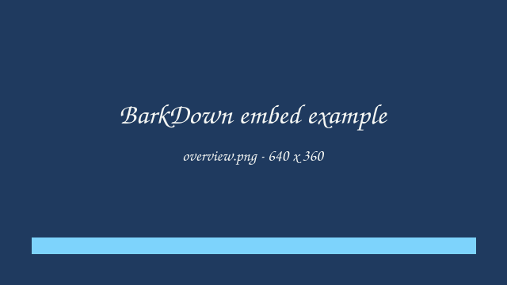

# External file embeds

This document shows every supported embed. Each file and media card has the
same header: a file badge or thumbnail, the name, and the Reload, Copy, and
Open actions. Document embeds stay open. Media starts collapsed; select the
card title to expand it.

## Interactive diagram

```barkdown-html
embed-examples/demo.html
```

## Formatted notes

```barkdown-text
embed-examples/notes.md
```

## People table

The first row supplies the column headings. Quoted fields can contain commas,
quotes, and line breaks. Cell markup stays text.

```barkdown-text
embed-examples/people.csv
```

## Plain text

```barkdown-text
embed-examples/readme.txt
```

## JSON source

```barkdown-text
embed-examples/data.json
```

## YAML source

```barkdown-text
embed-examples/config.yaml
```

## Image



## Native video

<video title="Product demo" controls preload="metadata" playsinline src="embed-examples/demo.mp4"></video>

## Hosted video


## Remote page

<iframe src="https://en.wikipedia.org/wiki/Blender_Foundation" title="Blender Foundation on Wikipedia"></iframe>
